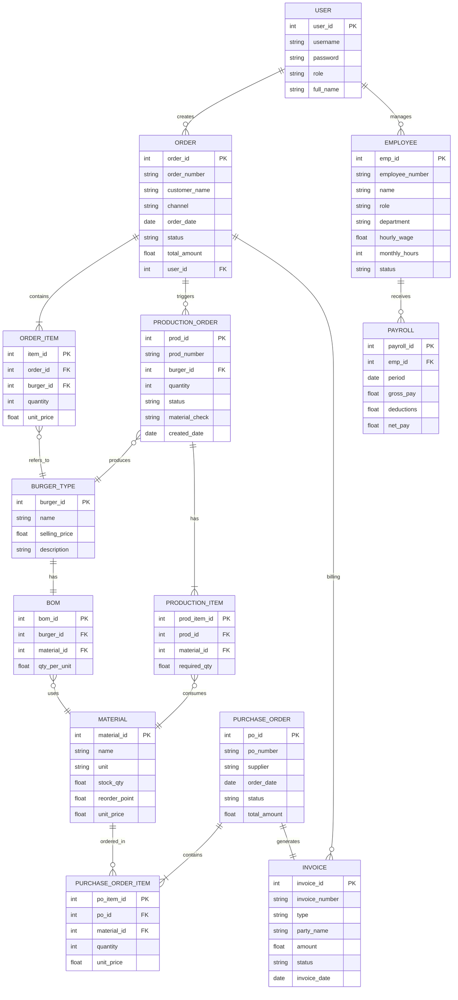
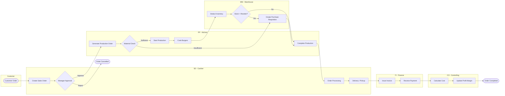
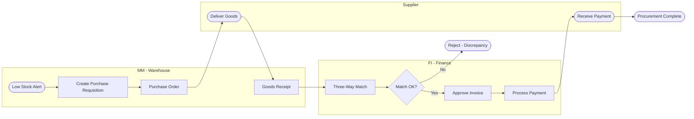
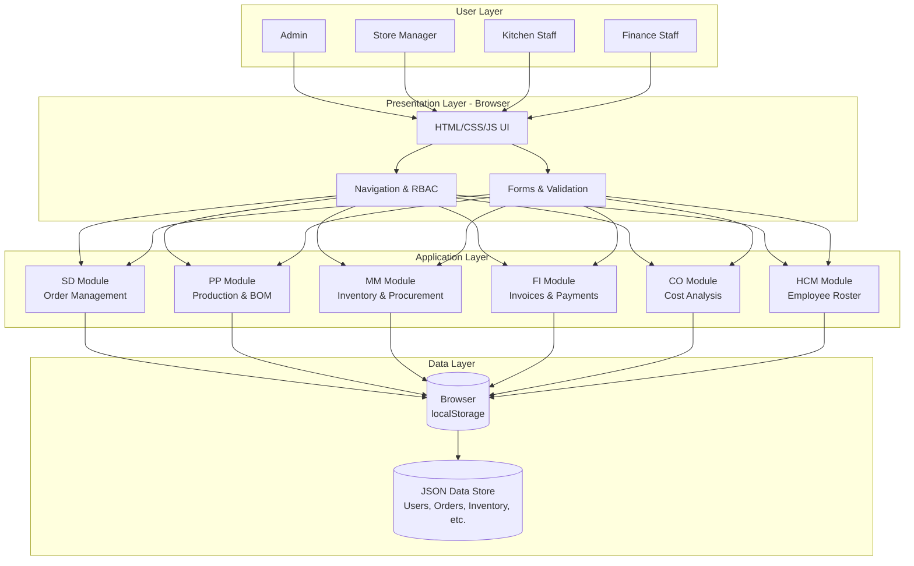
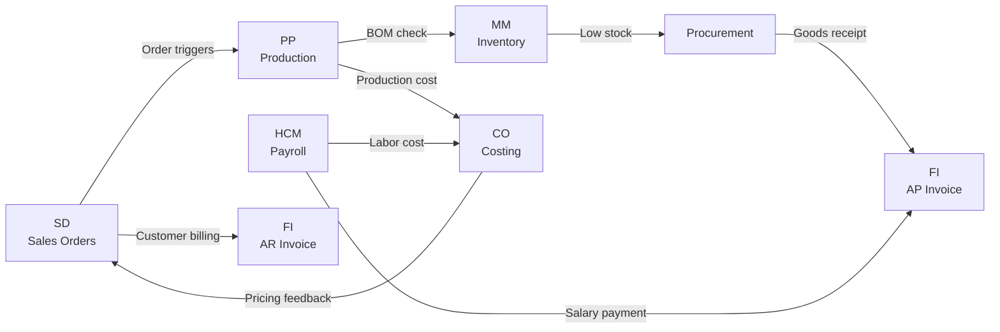

# SheepSheep Burger ERP - Diagrams

## 1. Entity Relationship Diagram (ERD)

---

## 2. BPMN Business Process - Order-to-Cash

---

## 3. BPMN Business Process - Procure-to-Pay

---

## 4. System Architecture Diagram

---

## 5. Module Interaction Map

